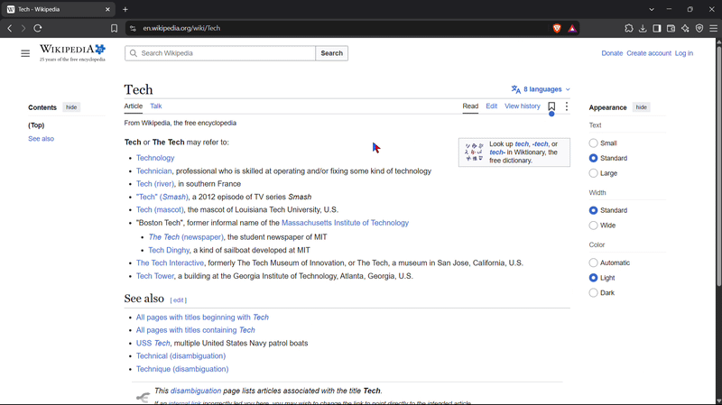

# Mouse Mode

A Windows accessibility tool that lets you do common tasks with **only the mouse**.
Turn it on with a hotkey, and a few button gestures plus a round pop-up menu replace
the keyboard shortcuts you'd normally need: copy, screenshot, typing by voice, switching apps, launching your own apps.

> **Status:** working prototype (v0.5.2), built with AutoHotkey v2. Windows 10/11 only.

## Why

Keyboard shortcuts are hard or impossible for some people (RSI, tremors, one-handed use,
limited mobility). Existing tools cover pieces of the problem (gesture tools, on-screen
keyboards, dwell clicking), but few combine them into one simple mouse-only setup.
This project is an attempt at that.

## Quick start

1. Go to the [**Releases**](../../releases) page and download `MouseMode-v0.5.2.zip`.
2. Unzip it and run `mousemode.exe`. **No installation and no AutoHotkey needed.**
3. Press `Ctrl+Alt+O` (or click the tray icon) to turn mouse mode on.
4. Right-click the tray icon and choose **Start with Windows** if you want it always available.

Keep the exe in one fixed folder (for example Documents). Your settings and shortcuts are saved next to it.

> **Windows may warn you** ("Windows protected your PC") because the program is unsigned: click **More info**, then **Run anyway**.
> Some antivirus tools flag programs that watch the mouse. It is a false positive, and the full source code is in this repository so you can check it.

**Prefer to run the script?** Install [AutoHotkey v2](https://www.autohotkey.com/), keep `mousemode.ahk`, `mousemode.cur` and `mousemode.ico` in the same folder, and double-click `mousemode.ahk`.

## How to use it

| Action | What happens |
|---|---|
| `Ctrl+Alt+O` or click the tray icon | Turn mouse mode on/off. The cursor turns half blue / half red while it's on. |
| **Hold right-click** | Copies the selection. "Copied" appears while you're still holding (only if something was really copied). |
| **Quick right-click** | Normal context menu (nothing that already works is replaced) |
| **Left + right click together** | Screenshot (Windows Snipping Tool) |
| **Hold right-click and scroll** | Opens the round menu under your cursor. Point at a slice and release to choose it. Release in the center to cancel. |

### Clipboard history

Everything you copy (with the hold-right-click gesture or the normal Ctrl+C) is remembered. Choose **Clipboard** in the round menu (or **Clipboard history** in the tray menu) and a list appears next to your cursor.

- **Click an item** to paste it into the app you were using.
- **Pin** an item to keep it at the top, or **x** to delete it. **Clear** removes everything that isn't pinned.
- **Scroll** the mouse wheel over the list for older items. Drag the top strip to move it.
- It keeps the newest 30 items plus anything you pinned.

Privacy: the history is **text only**, lives **in memory only** (it is never written to disk and is gone when you quit), and skips anything a password manager marks as sensitive. You can pause it any time from the tray menu (**Record clipboard history**).

### Swipe keyboard (slide to type)

Choose **Keyboard** in the round menu. A small keyboard appears at the bottom of the screen. It never steals focus, so whatever you type goes into the app you were using (click into a text box first).

- **Slide to type a word:** press the left button on the first letter, slide across the letters of the word, and release on the last letter. The best match is typed with a space after it.
- **Fix a wrong guess:** the other likely words appear in the strip above the keys. Click one to swap it in.
- **Tap keys** one by one for names, short words, or anything unusual. Tap **Shift** for a capital, **123** for numbers and symbols, and hold **Back** to keep deleting.
- **Move it** by dragging the top strip. **X** closes it.

How it finds the word: it compares the shape of your slide with the ideal path through the letters of each word in a built-in list of about 20,000 common English words, and favors common words when two paths are close. In a simulation with realistic hand wobble, the first choice was right about 95% of the time and the right word was in the top four almost always.

### Customize the cursor

Choose **Settings** in the round menu (or right-click the tray icon and choose **Customize cursor...**) to change:

- **Colors**: pick a preset (including a high-contrast one) or choose any color
- **Style**: split left | right, split top | bottom, or one solid color
- **Size**: small, medium, large, or extra large (helpful for low vision)
- **Outline**: black, white, or none

A live preview shows the cursor on a light and a dark background, and **Try it** lets you test it for a few seconds before saving.

### The round menu

The menu has **two pages**. **Scroll the mouse wheel while it is open** to flip between them (the center shows `1/2` or `2/2`).

**Page 1**
- **Keyboard**: opens the swipe keyboard (see below)
- **Voice**: starts Windows voice typing (choose it again to stop)
- **Settings**: opens the settings window, where you can customize the cursor (screenshots are still one gesture away: left + right click together)
- **OFF**: turns mouse mode off
- **Switch**: opens the Windows app switcher (like Alt+Tab) that stays open so you can click a window
- **Clipboard**: opens your clipboard history (see below)

**Page 2**
- **Circle**: circle to search (see below)
- **Your own shortcuts (up to 3)**: choose the **Add app** slice and pick any app or file. It shows the app's real icon. To remove one, point at the small **x** on its slice and left-click while holding right-click.

### Circle to Search

Choose **Circle** (page 2 of the round menu, or **Circle to search** in the tray menu). The screen freezes and darkens. **Draw a circle around anything with the left button.** When you let go, a window shows what you circled and the text found in it:

- **Search Google** and **Translate** open your browser with that text. You can fix the text first if the recognition made a mistake.
- **Copy text** and **Copy image** put the result on your clipboard.
- **Image search** sends the picture to Google Lens for you and opens the results. This uses an unofficial Google web address that Google could change, so as a backup the picture is also copied (press Ctrl+V on lens.google.com), and **Save image** lets you use "upload a file".
- **Save image** saves the picture in your Pictures folder and shows it in a folder window.
- **Right-click** while drawing cancels.

Text is read on your own PC with Windows' built-in text recognition (it needs a Windows OCR language, which English systems have by default). The picture is only sent to Google when you click Image search.

### Clipboard history

Everything you copy (with the hold-right-click gesture or the normal Ctrl+C) is remembered. Choose **Clipboard** in the round menu (or **Clipboard history** in the tray menu) and a list appears next to your cursor.

- **Click an item** to paste it into the app you were using.
- **Pin** an item to keep it at the top, or **x** to delete it. **Clear** removes everything that isn't pinned.
- **Scroll** the mouse wheel over the list for older items. Drag the top strip to move it.
- It keeps the newest 30 items plus anything you pinned.

Privacy: the history is **text only**, lives **in memory only** (it is never written to disk and is gone when you quit), and skips anything a password manager marks as sensitive. You can pause it any time from the tray menu (**Record clipboard history**).

### Swipe keyboard (slide to type)

Choose **Keyboard** in the round menu. A small keyboard appears at the bottom of the screen. It never steals focus, so whatever you type goes into the app you were using (click into a text box first).

- **Slide to type a word:** press the left button on the first letter, slide across the letters of the word, and release on the last letter. The best match is typed with a space after it.
- **Fix a wrong guess:** the other likely words appear in the strip above the keys. Click one to swap it in.
- **Tap keys** one by one for names, short words, or anything unusual. Tap **Shift** for a capital, **123** for numbers and symbols, and hold **Back** to keep deleting.
- **Move it** by dragging the top strip. **X** closes it.

How it finds the word: it compares the shape of your slide with the ideal path through the letters of each word in a built-in list of about 20,000 common English words, and favors common words when two paths are close. In a simulation with realistic hand wobble, the first choice was right about 95% of the time and the right word was in the top four almost always.

### Customize the cursor

Choose **Settings** in the round menu (or right-click the tray icon and choose **Customize cursor...**) to change:

- **Colors**: pick a preset (including a high-contrast one) or choose any color
- **Style**: split left | right, split top | bottom, or one solid color
- **Size**: small, medium, large, or extra large (helpful for low vision)
- **Outline**: black, white, or none

A live preview shows the cursor on a light and a dark background, and **Try it** lets you test it for a few seconds before saving.

### The round menu

- **Keyboard**: opens the swipe keyboard (see below)
- **Voice**: starts Windows voice typing (choose it again to stop)
- **Settings**: opens the settings window, where you can customize the cursor (screenshots are still one gesture away: left + right click together)
- **OFF**: turns mouse mode off
- **Switch**: opens the Windows app switcher (like Alt+Tab) that stays open so you can click a window
- **Clipboard**: opens your clipboard history (see below)
- **Your own shortcuts (up to 3)**: choose the **Add app** slice and pick any app or file. It shows the app's real icon. To remove one, point at the small **x** on its slice and left-click while holding right-click.

## Settings

`settings.ini` is created on first run. You can change the toggle hotkey and the hold time here. The cursor look is easiest to change from the tray menu (**Customize cursor...**).
Use **Reload** from the tray menu after editing. See `settings.example.ini`.

## Notes and limitations

- Windows 10/11 only.
- Voice typing uses Windows' built-in dictation (Win+H). It needs a microphone, an internet connection, and "Online speech recognition" turned on in Windows settings.
- While the mode is on, the system arrow cursor is replaced. It is restored when you turn the mode off or quit.
- Swipe typing works with English words from the built-in list. Words that aren't in it (names, slang) can be typed by tapping the keys. Typing into apps that run as administrator needs this program to run as administrator too.
- Some apps that draw their own cursor (games) ignore the cursor color change.
- Apps running as administrator may ignore the gestures unless this program is also run as administrator.
- With all 3 shortcuts added, the menu has 8 slices and the labels are small.

## Roadmap

- [x] Own on-screen keyboard with swipe typing
- [ ] Learn new words and your most-used words
- [ ] Circle to Search: pick a lasso shape instead of a box, and search images without pasting
- [ ] Clipboard history for images, and pinned items that survive a restart
- [ ] More languages
- [ ] Paste / Undo slices
- [ ] Dwell click and drag lock
- [ ] Settings window and installer
- [ ] Testing with people who rely on assistive tech

## How it works (short)

AutoHotkey v2 handles the global mouse hooks. The round menu is drawn with GDI+ into a
per-pixel-transparent, click-through window that never takes focus, so shortcuts like copy
still go to the app you were using. Slices are picked by the angle and distance of the
cursor from the menu center.

## Credits

The word list `words.txt` for swipe typing was generated with [wordfreq](https://github.com/rspeer/wordfreq) (code under Apache-2.0; its word-frequency data is released under Creative Commons Attribution-ShareAlike 4.0, so `words.txt` should be treated the same way) and filtered with [better-profanity](https://github.com/snguyenthanh/better_profanity). `build_words.py` shows how it was made. Check the wordfreq project for its exact license terms.

Built with [AutoHotkey](https://www.autohotkey.com/), an open-source project. The released `.exe` is the script compiled with AutoHotkey's own compiler (Ahk2Exe), so it contains the AutoHotkey runtime.

## License

MIT, see `LICENSE`.
